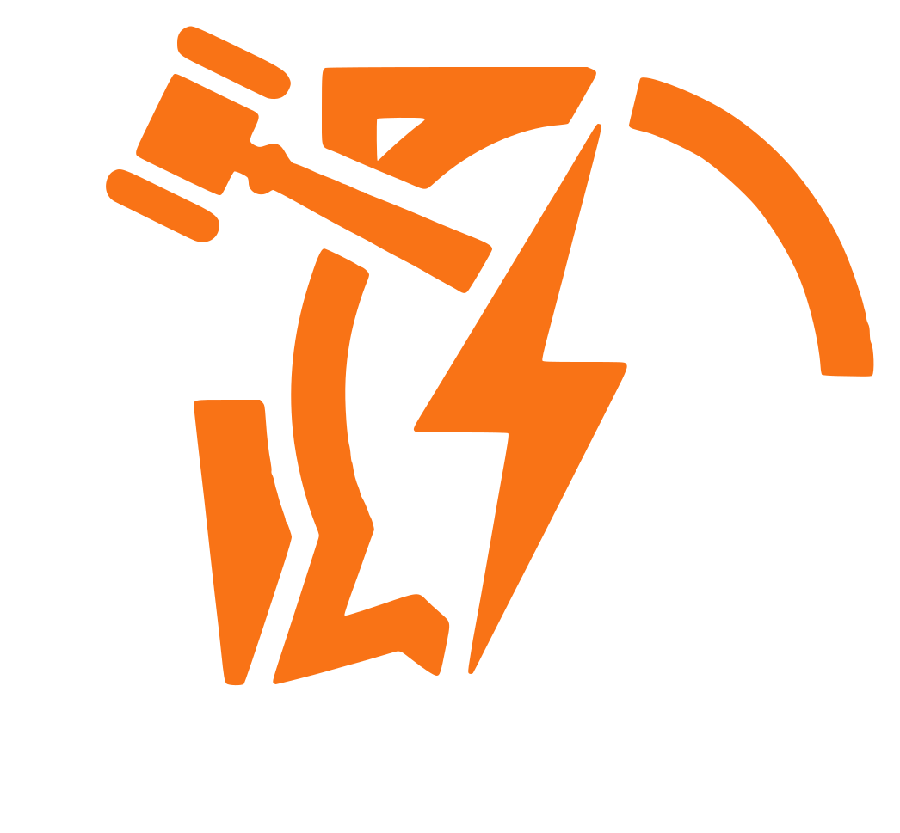

<!-- Don't delete it -->
<div id="readme-top"></div>

<!-- Organization & Project Logos -->
<p align="center">
  
  &nbsp;&nbsp;&nbsp;&nbsp;
  
</p>

<!-- Live at URL (To be configured later) -->
<p align="center">
  <!-- Live at URL will be configured later -->
  <a href="https://hub.debateai.aossie.org/">
    
  </a>
</p>

<!-- Community & Social Handles -->
<p align="center">
  <a href="https://discord.gg/hjUhu33uAn"></a>
  &nbsp;
  <a href="https://x.com/aossie_org"></a>
  &nbsp;
  <a href="https://t.me/+bMWGzaMTMa8xN2Ex"></a>
  &nbsp;
  <a href="https://www.linkedin.com/company/aossie/"></a>
  &nbsp;
  <a href="https://www.youtube.com/@AOSSIE-Org"></a>
  &nbsp;
  <a href="https://www.youtube.com/@StabilityNexus"></a>
</p>

---

<div align="center">
  <h1>DebateAI Landing Page</h1>
  <p><strong>A high-performance, server-agnostic gateway to real-time AI-powered debates.</strong></p>
</div>

<p align="center">
  <a href="https://scorecard.dev/viewer/?uri=github.com/AOSSIE-Org/DebateAI-LandingPage">
    </a>
  &nbsp;&nbsp;
  <a href="./BestPracticesChecklist.md">
    </a>
  &nbsp;&nbsp;
  <a href="https://github.com/gitleaks/gitleaks">
    </a>
</p>

<p align="center">
  
  &nbsp;
  
  &nbsp;
  
  &nbsp;
  
  &nbsp;
  
</p>

---

## 📖 About DebateAI & The Landing Page

**DebateAI** is an open-source, AI-enhanced real-time debating platform developed under [AOSSIE](https://aossie.org) (Australian Open Source Software Innovation and Education). It enables users to sharpen their rhetorical and analytical reasoning skills by engaging in structured debates against human opponents or LLM-powered AI adversaries, evaluated and judged by AI.

This repository hosts the **DebateAI Landing Page**, an ultra-responsive, cloudless web client built with **Vite 8**, **React 19**, and **Tailwind CSS v4**. It acts as the gateway to the DebateAI ecosystem, allowing users to:
1. **Try it out immediately** on the official managed AOSSIE server.
2. **Connect to community servers** hosted by schools, universities, or independent groups via custom server URLs.
3. **Learn how to self-host** an independent DebateAI instance using Docker Compose with sovereign credentials and user management.

---

## 🚀 Key Features

- **🌐 Server-Agnostic ("Cloudless") Client Architecture**  
  Built as a sovereign static client running entirely inside the browser. Users can connect to any self-hosted or community backend server dynamically by passing a query parameter (e.g., `?server=https://debate.your-school.edu`).

- **⚡ Instant "Try It Out" Access**  
  Quick single-click redirection to launch directly into the official AOSSIE DebateAI platform.

- **🔗 Connect to Any Community Server**  
  An interactive connection modal with URL validation and error handling for joining private, school, or club debate servers.

- **🐳 Comprehensive Self-Hosting Guide**  
  Interactive in-app guidance modal detailing Docker Compose deployment, environment variable configuration, and deployment on self-hosting platforms like Coolify and Dokploy.

- **🎭 Dynamic Debate Arena Visualization**  
  Engaging vector artwork illustrating real-time debates (proponent vs. opponent with structured arguments).

- **🌓 Seamless Dual Theme System**  
  Smooth transitions between Light, Dark, and System-preferred color palettes via semantic CSS variables and Tailwind CSS v4.

- **📱 Fully Responsive Design**  
  Flawless mobile, tablet, and desktop viewing experience built to match official AOSSIE design specifications.

---

## 💻 Tech Stack

| Technology | Role |
| :--- | :--- |
| **[React 19](https://react.dev/)** | Core user interface library |
| **[Vite 8](https://vite.dev/)** | Next-generation frontend tooling and bundler |
| **[Tailwind CSS v4](https://tailwindcss.com/)** | Utility-first modern CSS framework with native CSS variables |
| **[React Router DOM v7](https://reactrouter.com/)** | Client-side routing and navigation |
| **[React Icons](https://react-icons.github.io/react-icons/)** | Comprehensive vector iconography (FontAwesome 6, Heroicons, Bootstrap) |
| **[Embla Carousel](https://www.embla-carousel.com/)** | Lightweight, high-performance carousel with autoplay capabilities |
| **[ESLint 10](https://eslint.org/)** | Code quality and linting |

---

## 📂 Project Structure

```text
DebateAI-LandingPage/
├── .github/
│   └── workflows/                # GitHub Actions (CI & automated GitHub Pages deployment)
├── public/                       # Static public assets
│   ├── brand/
│   │   ├── Brand.md              # Branding guidelines
│   │   └── icons/                # Organization & project vector assets
│   │       ├── aossie_logo.svg   # Official AOSSIE vector logo
│   │       └── debateai_logo.svg # Official DebateAI vector logo
│   ├── favicon.ico               # Browser favicon
│   ├── favicon.svg               # Browser vector favicon
│   ├── llms.txt                  # LLM crawler directives
│   └── robots.txt                # Search engine crawler policies
├── src/
│   ├── assets/                   # Vector graphics & illustration assets (DebateCover4.svg)
│   ├── components/               # Modular UI components
│   │   ├── ConnectServerModal.jsx      # Modal for connecting to custom backend URLs
│   │   ├── DebateCarousel.jsx          # Interactive debate carousel
│   │   ├── DebateCoverIllustration.jsx # Responsive debate arena illustration
│   │   ├── Footer.jsx                  # Footer with AOSSIE branding and links
│   │   ├── Header.jsx                  # Header navigation and theme toggle
│   │   ├── SelfHostGuideModal.jsx      # Step-by-step Docker self-hosting instructions
│   │   └── ThemeToggle.jsx             # Light/Dark mode switcher
│   ├── context/
│   │   └── ThemeContext.jsx      # React context managing theme state
│   ├── lib/
│   │   └── connect.js            # URL parsing & server redirection logic
│   ├── pages/
│   │   └── LandingPage.jsx       # Main landing page view
│   ├── App.jsx                   # Root application routing
│   ├── index.css                 # Global theme variables & Tailwind v4 styling
│   └── main.jsx                  # Application entry point
├── CONTRIBUTING.md               # Contribution workflow and guidelines
├── COPYRIGHT.md                  # Copyright statement
├── DCO.md                        # Developer Certificate of Origin
├── MAINTAINERS.md                # Project maintainers and roles
├── index.html                    # Root HTML document
├── package.json                  # Scripts and dependencies
└── vite.config.js                # Vite build configuration
```

---

## ⚡ Getting Started

### Prerequisites

Ensure you have the following installed on your machine:
- **Node.js**: `v20.9.0` or higher
- **npm**: `v9.0.0` or higher
- **Git**

### Installation

1. Clone the repository:
   ```bash
   git clone https://github.com/AOSSIE-Org/DebateAI-LandingPage.git
   cd DebateAI-LandingPage
   ```

2. Install dependencies:
   ```bash
   npm install
   ```

3. Start the local development server:
   ```bash
   npm run dev
   ```

4. Open your browser and navigate to `http://localhost:5173` (or the port indicated in your terminal).

### Available Scripts

- `npm run dev`: Starts the Vite development server with Hot Module Replacement (HMR).
- `npm run build`: Compiles and bundles production-ready assets into the `dist/` directory.
- `npm run preview`: Locally previews the production build.
- `npm run lint`: Runs ESLint to check for code style issues and bugs.
- `npm test`: Runs automated unit tests with Vitest.

---

## 🌐 Server Routing & Connection Modes

The landing page connects to DebateAI backend instances using query parameters:

| Mode | URL Example | Description |
| :--- | :--- | :--- |
| **Official Server** | `https://debateai.aossie.org/?server=official` | Connects directly to AOSSIE's publicly hosted server. |
| **Community Server** | `https://debateai.aossie.org/?server=https://debate.your-school.edu` | Routes to an institution or club server. |
| **Local / Dev Server** | `http://localhost:5173/?server=http://localhost:1313` | Useful for local development and testing with a local Go backend. |

---

## 📋 Project Maturity & Checklist

* [x] Organization logo (`public/brand/icons/aossie_logo.svg`) & Project logo (`public/brand/icons/debateai_logo.svg`).
* [x] Browser favicon and web metadata (`index.html`, `public/favicon.svg`).
* [x] Responsive debate cover illustration.
* [x] "Try it out" instant play integration.
* [x] Custom server connection modal with input validation.
* [x] Self-hosting Docker Compose guide modal.
* [x] Dual theme support (Light / Dark mode).
* [x] AOSSIE organization footer with social and community channels.
* [x] Automated CI / CD workflows (`.github/workflows/`).
* [x] CodeRabbit automated AI code review integration (`.coderabbit.yml`).
* [x] Open-source compliance documentation (`DCO.md`, `COPYRIGHT.md`, `CONTRIBUTING.md`, `MAINTAINERS.md`).
* [x] OpenSSF Scorecard & Best Practices compliance ([`BestPracticesChecklist.md`](BestPracticesChecklist.md), [`SECURITY.md`](SECURITY.md), [`CHANGELOG.md`](CHANGELOG.md)).

---

## 🤝 Contributing

Contributions are always welcome! Whether you are fixing bugs, improving the user experience, enhancing documentation, or adding new features:

1. Read our [`CONTRIBUTING.md`](CONTRIBUTING.md) and [`DCO.md`](DCO.md).
2. Fork the repository and create your feature branch:
   ```bash
   git checkout -b feat/your-feature-name
   ```
3. Commit your changes following conventional commit syntax:
   ```bash
   git commit -m "feat: description of changes"
   ```
4. Push to your branch and open a Pull Request.

### 💬 Community & Support

Join the conversation with mentors and contributors:
- **Discord**: Join the [AOSSIE Discord](https://discord.gg/hjUhu33uAn) and head over to the `#AI for Debate` channel in the [AOSSIE Server](https://discord.com/channels/1022871757289422898/1312986807914463252).
- **Telegram**: [AOSSIE Telegram Group](https://t.me/+bMWGzaMTMa8xN2Ex)
- **Main DebateAI Repository**: [AOSSIE-Org/DebateAI](https://github.com/AOSSIE-Org/DebateAI)

---

## 📄 License

This project is licensed under the Apache 2.0 / Open Source License. See repository headers and [`COPYRIGHT.md`](COPYRIGHT.md) for details.

© 2026 AOSSIE (Australian Open Source Software Innovation and Education).
